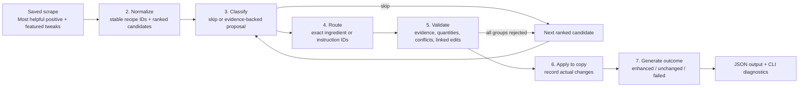

# Recipe Enhancement Pipeline: My Engineering Approach

## Executive summary

I treated this assessment as a reliability problem before a user-interface problem. The product should do more than generate a plausible recipe variation. It should identify a useful community suggestion, apply every supported change to the right recipe lines, and show users why each change was made.

I made that process explicit and inspectable. I defined seven stages, added clear data boundaries, used exact IDs for routing, and carried evidence from each applied change back to its review and supporting quote. I evaluated the integrated pipeline on a held-out set and used observed failures to improve the proposal prompt. The latest results are 9/10 for review selection, 6/10 for proposal correctness, and 10/10 for both accepted edit application and recipe completeness. Proposal quality and human evaluation still need more work.

## Problem analysis and architecture

The inherited pipeline appeared complete, but a successful run did not prove that it worked as intended. The assessment specifically asks whether the system captures every change in a review. I also looked for other ways the product could fail:

- A popular review may not suggest a useful recipe change.
- A useful review may be vague or mix supported and unsupported suggestions.
- The model may miss one change, combine incompatible changes, or suggest an unsupported amount.
- Similar ingredient names can make fuzzy matching ambiguous. For example, “sugar” could mean brown sugar or white sugar.
- A proposal may point to a missing recipe line, conflict with another change, or make a quantity invalid.
- Users need to see which review supports each change, not just the final recipe.

I treated these as separate failure modes. I made each one visible and added deterministic checks where possible.

### Pipeline flow

When no candidates remain, I return an unchanged outcome with diagnostics. I expose the stages independently for inspection and provide an integrated `run` command that advances to the next candidate after a semantic skip or when validation rejects every proposed edit.

## Assumptions and product rules

- I treat scraped recipe text and review metadata as the source of truth. Later stages should not silently invent missing source content.
- I consider eligible five-star reviews and use helpfulness to order candidates. If a candidate has no meaningful modification, I move to the next eligible candidate.
- I allow a review to support multiple changes. I preserve compatible changes and consolidate or reject conflicts with a diagnostic.
- I keep each instruction as one source line. I let the model quote the relevant part of a review as evidence rather than splitting instructions into artificial sentence-level targets.
- I require actionable edits. For example, “use a little less sugar” is not enough when a recipe needs a specific amount.
- I treat helpful votes as a prioritization signal, not proof that a suggestion is safe or correct. I still require proposal checks and validation.

## My seven-stage solution

| Stage | What I built | Boundary I wanted to make clear |
|---|---|---|
| 1. Scrape | Collect recipe fields, the most-helpful review, and featured tweaks | Preserve source text and available review metadata |
| 2. Load and normalize | Create a consistent recipe and ordered review-candidate list | Assign stable, padded IDs to ingredient lines and instruction steps; preserve the original text |
| 3. Classify and propose | Decide whether a review suggests a meaningful improvement and propose supported changes | Skip semantic non-candidates and continue through the ordered list; distinguish skips from operational failures |
| 4. Route | Map each proposal to an exact ingredient or instruction ID | Avoid guessing between similar lines with fuzzy matching |
| 5. Validate | Check references, evidence, quantities, and conflicts | Reject invalid groups with diagnostics while keeping independent valid groups |
| 6. Apply | Apply validated changes to a copy of the recipe | Record actual before-and-after values and avoid returning a partial result after an error |
| 7. Generate enhanced recipe | Package the recipe, applied changes, and evidence | Link every enhancement to its review ID and supporting quote |

I kept these boundaries separate so I could inspect and evaluate each stage. I use the model to interpret language, then rely on deterministic logic for exact target resolution and many safety checks.

### Model and prompting approach

I configured `openai/gpt-6-luna` as the default model through the project's OpenAI-compatible OpenRouter client. I use the model at the semantic boundary: interpreting review language and returning structured proposals. I keep normalization, exact-ID routing, validation, application, and evidence packaging in inspectable pipeline stages.

I built the Stage 3 prompt from explicit rules and 21 compact JSON examples. The rules cover when to skip a review, how to preserve compatible changes, how to handle conflicts, what counts as a quantifiable edit, and which references are valid. The examples show positive, negative, and edge cases. This gives the model concrete patterns while keeping prompt size measurable. The rules and examples are about 5,657 tokens with the local `cl100k_base` tokenizer.

I have not compared this model with alternatives, so I cannot claim it is the best model for this task. I chose it as the project's configurable default and kept the model swappable. I would compare models on the same held-out recipes and score review selection, proposal correctness, and successful application separately.

## Technical decisions and rationale

### I chose stable IDs over fuzzy matching

Ingredient names can be similar. A fuzzy match for “sugar” could select the wrong line when a recipe contains both brown and white sugar. I assign each ingredient and instruction a stable ID within the recipe snapshot, and I require routing to use an exact ID. Before applying a change, I check that the source target still matches.

### I preserved source text and structure

I keep the original ingredient and instruction strings in the normalized data. When parsing is reliable, I also store structured quantities and units. This lets later stages run checks without losing the original wording users need to follow.

### I separated interpretation from enforcement

Stage 3 uses an LLM to interpret review language and propose changes. Later stages check exact targets, review evidence, supported numeric changes, and conflicts. This lets the system interpret natural language while keeping important application rules predictable. I emit diagnostics for invalid groups instead of silently dropping them.

### I made evidence part of the output contract

I treat the enhanced recipe as more than rewritten recipe text. Each enhancement includes the selected review ID, a supporting quote, and a record of what actually changed. This makes the result inspectable and gives a future UI the information it needs to show line-level provenance.

## Implementation and challenges

I added separate Stage 3–7 CLI entry points and an integrated `run` command while keeping the existing baseline modes. I write JSON to stdout and progress messages or diagnostics to stderr. This lets me monitor a run without mixing logs into machine-readable output. Only the interpretation and proposal stage calls a provider; I can run routing, validation, application, and output packaging offline.

These issues required changing pipeline behavior, not just adding happy-path code:

- I made semantic skips advance to the next candidate. I keep them separate from timeouts, malformed responses, and other operational failures.
- I made IDs consistently zero-padded. I reject malformed references instead of silently correcting model output.
- I handle multiple changes to one target as a group. I consolidate compatible changes and log conflicts rather than applying an arbitrary order.
- I require evidence and validation for quantity and instruction changes. I reject edits that are not quantifiable or whose numeric change is unsupported.
- I assign deterministic IDs and ordering to insertions. I also preserve actual before-and-after values for the evidence trail.

## Evaluation and results

I ran the integrated pipeline on the same ten held-out scrapes used for the baseline comparison. The model judged each new run's review trace and final recipe against the saved input and the baseline output.

| Metric | Baseline | New pipeline |
|---|---:|---:|
| Correct review selection | 5/10 | 9/10 |
| Correct proposed edits | 2/10 | 6/10 |
| Accepted ingredient and instruction edits applied correctly | 10/10 | 10/10 |
| Is the recipe complete? | 0/10 | 10/10 |

The first two checks use the spec's rubric: a correct review is the earliest eligible five-star review by helpful-vote order that supports an applicable change; a correct proposal captures the supported changes, targets, and values. I split the original application/preservation check into two diagnostic scores. Edit application checks that validated ingredient and instruction edits appear in the final lists while unrelated lines retain their content and order. **Is the recipe complete?** checks that the final output contains the complete ingredient and instruction lists and preserves the source recipe ID, title, and supplied prep time, cook time, total time, servings, and yield. The [held-out evaluation summary](../../evals/evaluation-summary.md) has per-recipe scores and the full definitions.

All ten new runs returned enhanced recipes. They applied 12 modification groups containing 26 edits, and all 18 published evidence quotes matched the selected reviews. The new pipeline missed review selection on recipe 15641 and proposal correctness on recipes 13974, 15641, 24380, and 255272.

I also compared reconstructed input-prompt content using local `tiktoken` 0.12.0 with `cl100k_base`. The baseline prompt averages 720 tokens per selected review request; the new prompt averages 6,319, about 8.8 times as many.

## AI failure modes and UX guardrails

| Failure mode I considered | Guardrail I added | What the user should see |
|---|---|---|
| A popular review suggests no useful change | Stage 3 can skip it and inspect the next eligible candidate | The system does not fabricate an edit |
| A review suggests several changes | The prompt asks for all supported changes and consolidation by target | Independent valid changes can appear together |
| A review is too vague for an actionable recipe | I require a supported, quantifiable change when an amount is needed | I reject the vague edit and keep the original recipe |
| The model targets an ambiguous or missing line | I route by exact normalized ID and validate references | I report the issue instead of guessing |
| Two changes conflict | I consolidate compatible changes and reject or log conflicts | The output explains which changes were applied and why others were rejected |
| The model response is malformed or a call fails | I use bounded retries and an explicit failure state, distinct from semantic skip | The error remains visible for analysis instead of looking like “no change” |
| An applied edit loses its source | I require a review ID and supporting quote in the output | Users can inspect why an enhancement was produced |

## Future improvements

### Technical

1. **Capture provider performance data.** I would record actual latency, retries, and provider-reported token usage alongside the reconstructed prompt-content token counts.
2. **Improve current methodology to lower the cost while maintaining accuracy** I would iterate on the current implementation, specially on the LLM part to lower cost without sacrificing performance
3. **Improve quantity interpretation while preserving meaning.** I would support more quantity formats and conversions while preserving the source amount, unit, and intended meaning. I would validate each new case before applying it.

### Evals

1. **Test in larger dataset to capture more unseen data/scenario and improve pipeline's performance..** I would use a larger, more varied recipe set, including reviews with multiple changes, repeated ingredients, conflicts, missing metadata, and no eligible review. I would analyze errors by failure type and add newly found gaps to regression tests.
2. **Build autonomus LLM as Judge** Automate evals by building a reliable llm as judge pipeline

### Product

1. **Show that a recipe is community enhanced.** The pipeline output already carries the selected review and evidence, but I would add a user-facing view that makes this provenance clear.
2. **Let users try on another review.** I would let users request an alternative based on another eligible community tweak if they do not like the current enhancement, while keeping the evidence for each version.
3. **Adjust recipe metadata.** I would update prep time, cook time, total time, servings, and yield when a modification affects them, and explain the change.
4. **Update nutrition information.** I would recalculate nutrition from the enhanced ingredients and serving size, and label the values as estimates when appropriate.
5. **Add food-safety validation.** I would check relevant ingredient handling, cooking temperatures, and time guidance before presenting an enhanced recipe as safe to follow.
