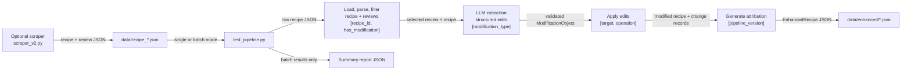
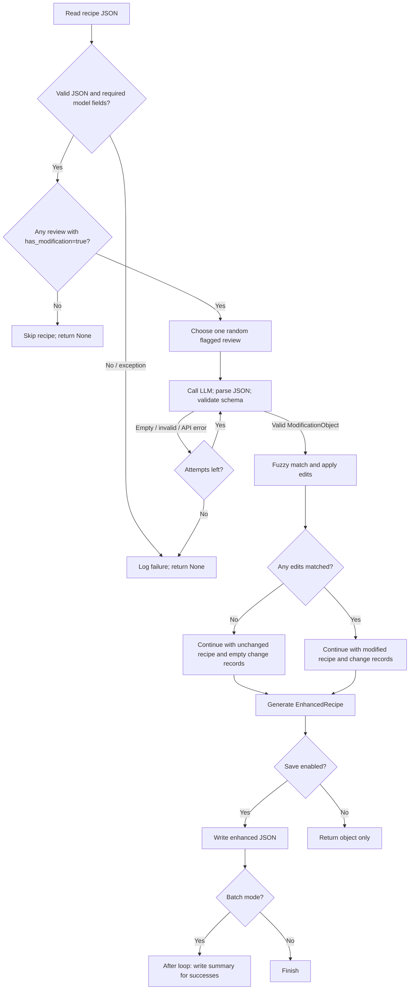
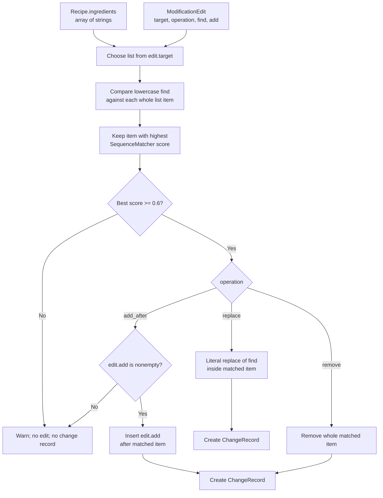

# Map the data pipeline
LINK TO CONVERSATION -> [https://chatgpt.com/s/cx_6b03ad108674819184ecfb58cf6342b9]

> I'm new to this codebase and want to understand how its pipeline works, not\
> file by file, but how data moves through the system. I'm a visual learner.\
> \
> Before you start, ask me up to 5 short clarifying questions (e.g., which\
> entry point or feature I care about, how deep I want to go, what I already\
> know about the stack). Then proceed.\
> \
> Your job:\
> \
> 1\. HIGH-LEVEL MAP\
> &#x20;  Give me a system-design-style diagram (Mermaid) of the whole pipeline:\
> &#x20;  entry points -> stages/services -> storage/queues -> outputs. Label each\
> &#x20;  arrow with what travels along it (e.g., "OrderCreated JSON", "row in\
> &#x20;  orders table"). Keep it to one screen, around 5-10 boxes.\
> \
> 2\. TRACE ONE REAL EXAMPLE\
> &#x20;  Pick one concrete scenario (the most common happy path) and follow a\
> &#x20;  single piece of data from input to final output. Find or construct a\
> &#x20;  realistic sample payload from tests, fixtures, or docs. Don't invent\
> &#x20;  fields that don't exist in the code.\
> \
> 3\. STAGE-BY-STAGE BREAKDOWN\
> &#x20;  For each stage, give me:\
> &#x20;  \- Name and purpose, in one sentence\
> &#x20;  \- Where it lives in code (file:function), for reference only\
> &#x20;  \- INPUT: the data shape here, shown as a JSON example\
> &#x20;  \- WHAT HAPPENS: the transformation, validation, enrichment, or decision\
> &#x20;  \- OUTPUT: the data shape after, with changed, added, or removed fields\
> &#x20;    highlighted (a diff-style view works well)\
> &#x20;  \- What can go wrong here (errors, retries, dead-letter paths)\
> \
> 4\. FIELDS THAT MATTER\
> &#x20;  Identify fields that control behavior: flags, status or state fields,\
> &#x20;  type or enum discriminators, IDs used for joins or idempotency, feature\
> &#x20;  toggles, version fields. For each, tell me:\
> &#x20;  \- Where it's set and who reads it\
> &#x20;  \- What values it can take and what each value triggers\
> &#x20;  \- What breaks or changes if it's missing or wrong\
> &#x20;  Present these as a table, and mark them on the stage diagrams.\
> \
> 5\. BRANCHES AND STATES\
> &#x20;  Show the alternative paths (failure, retry, skip, different flag values)\
> &#x20;  as a second diagram, ideally a state machine or flowchart. Show where the\
> &#x20;  same data diverges based on a field value.\
> \
> 6\. SUMMARY\
> &#x20;  End with a one-paragraph mental model I could explain to a teammate, plus\
> &#x20;  a list of the 3-5 places I should read first to go deeper.
>
> 7\. EXISTING GAP & POOR ASSUMPTIONS IN THE CODEBASE\
> &#x20;   Flag any gaps or weak assumptions you notice in the codebase along the way, like missing validation, fields that are assumed to always exist, error cases that aren't handled, silent failures, or places where the code relies on something that might not be true. Separate what you can see in the code from what you're guessing, and tell me how serious each one seems.\
> \
> Rules:\
> \- Base everything on the actual code. If you're inferring, say so and mark\
> &#x20; your confidence.\
> \- Prefer diagrams and concrete JSON examples over prose.\
> \- Keep the explanation of each stage short; I'll ask for depth where I need it.\
> \- If the pipeline has multiple distinct flows, list them first and let me\
> &#x20; pick one rather than covering everything at once.

<details><summary>7 previous messages</summary>

> I’ll map the actual data flow from the code and examples, then trace the clearest happy path. A few quick questions will help me pitch the explanation; I’ll inspect the repo while you answer.
>
> Which pipeline or entry point interests you most?
> - Main app flow
> - A specific feature
> - Choose the common path
>
> How deep should the explanation go?
> - Big picture + key details
> - Implementation details
> - Beginner level
>
> How familiar are you with the codebase’s language and stack?
> - New to this stack
> - Know the basics
> - Comfortable with it
>
> <details><summary>Ran 2 commands</summary>
>
> - Ran `Get-ChildItem -Force | Select-Object Mode,Name; rg --files -g 'AGENTS.md' -g 'README*' -g 'package.json' -g 'pyproject.toml' -g 'Cargo.toml' -g 'go.mod' -g 'pom.xml' -g '*.md' | Select-Object -First 100`
> - Ran `Get-Content README.md; rg --files src data docs`
>
> </details>
>
> This repo has two distinct flows: an optional scraper that writes recipe JSON, and an enhancement pipeline that reads recipe JSON and writes enhanced recipes plus a summary. I’m checking the pipeline’s branches and sample data now; I’ll focus the full walkthrough on the enhancement pipeline unless you steer me to scraping.
>
> <details><summary>Ran 2 commands</summary>
>
> - Ran `Get-Content src\test_pipeline.py; Get-Content src\llm_pipeline\pipeline.py; Get-Content src\llm_pipeline\tweak_extractor.py; Get-Content src\llm_pipeline\recipe_modifier.py; Get-Content src\llm_pipeline\enhanced_recipe_generator.py; Get-Content src\llm_pipeline\models.py; Get-Content src\llm_pipeline\prompts.py; Get-Content pyproject.toml`
> - Ran `rg -n "^    def |random|has_modification|difflib|SequenceMatcher|similarity|fuzzy|return None|raise|Literal|class " src\llm_pipeline\*.py src\scraper_v2.py; Get-Content data\recipe_10813_best-chocolate-chip-cookies.json -TotalCount 150; Get-Content data\enhanced\enhanced_10813_best-chocolate-chip-cookies.json -TotalCount 180; Get-Content src\llm_pipeline\tweak_extractor.py; Get-Content src\llm_pipeline\recipe_modifier.py`
>
> </details>
>
> **Which pipeline or entry point interests you most?**
>
> Main app flow
>
> **How deep should the explanation go?**
>
> Implementation details
>
> **How familiar are you with the codebase’s language and stack?**
>
> New to this stack
>
> <details><summary>Ran a command</summary>
>
> - Ran `$f='src\llm_pipeline\enhanced_recipe_generator.py'; $n=0; Get-Content $f | ForEach-Object { $n++; '{0,4}: {1}' -f $n,$_ }; $f='src\scraper_v2.py'; $n=0; Get-Content $f | ForEach-Object { $n++; if($n -le 180 -or ($n -ge 220 -and $n -le 330) -or ($n -ge 380 -and $n -le 445)) {'{0,4}: {1}' -f $n,$_} }; $f='src\llm_pipeline\pipeline.py'; $n=0; Get-Content $f | ForEach-Object { $n++; if($n -le 310) {'{0,4}: {1}' -f $n,$_} }`
>
> </details>
</details>

# 1. High-level map

There are two entry points: an **optional scraper** and the **main enhancement flow**. The scraper saves recipe JSON files; the enhancement flow can also start directly from the recipe files already in `data/`. The main flow has no queue or database: it reads and writes files on disk.



For the walkthrough below, I’ll follow the **enhancement pipeline**. The sample is the chocolate chip cookie recipe in the repo. Each run selects **one random review** marked `has_modification`; the example review is therefore a concrete illustration, not a promise that every run picks it.

# 2. Trace one example

The input recipe is [`recipe_10813_best-chocolate-chip-cookies.json`](/C:/Users/ubvw/Desktop/casper_studio/ai-assignment/ai-eng-assignment/data/recipe_10813_best-chocolate-chip-cookies.json). One of its reviews says:

> “I used an ice cream scoop, that made 16 big cookies. I did add an additional egg yolk to help keep the cookie chewy.They turned out fantastic.”

Its input shape includes:

```json
{
  "recipe_id": "10813",
  "title": "Best Chocolate Chip Cookies",
  "ingredients": ["1 cup butter, softened", "2 eggs", "1 teaspoon baking soda"],
  "instructions": ["Dissolve baking soda in hot water. Add to batter along with salt."],
  "reviews": [
    {
      "text": "I used an ice cream scoop, that made 16 big cookies. I did add an additional egg yolk to help keep the cookie chewy.They turned out fantastic.",
      "rating": 5,
      "has_modification": true
    }
  ]
}
```

The pipeline parses the recipe and review, sends the review and recipe context to the LLM, then expects a structured edit. The repo’s existing enhanced-cookie JSON contains a matching egg-yolk change, but it also has signs of a different pipeline version; I use it as an example of the data, not proof of what a fresh run will produce.

```json
{
  "modification_type": "addition",
  "reasoning": "Adding an additional egg yolk helps keep the cookies chewy.",
  "edits": [
    {
      "target": "ingredients",
      "operation": "add_after",
      "find": "2 eggs",
      "add": "1 additional egg yolk"
    }
  ]
}
```

The modifier inserts the ingredient after the matched list item. The generator adds attribution and summary metadata, then saves the enhanced recipe. For this example, the key ingredient change is:

```diff
  "ingredients": [
    "1 cup butter, softened",
-   "2 eggs",
+   "2 eggs",
+   "1 additional egg yolk",
    "1 teaspoon baking soda"
  ]
```

The final output includes `recipe_id: "10813_enhanced"`, `original_recipe_id: "10813"`, the updated ingredient list, a `modifications_applied` record citing the review, an `enhancement_summary`, `created_at`, and `pipeline_version`.

# 3. Stage-by-stage

Code locations below are references. The main orchestration is in [`pipeline.py`](/C:/Users/ubvw/Desktop/casper_studio/ai-assignment/ai-eng-assignment/src/llm_pipeline/pipeline.py), the models are in [`models.py`](/C:/Users/ubvw/Desktop/casper_studio/ai-assignment/ai-eng-assignment/src/llm_pipeline/models.py), and the CLI wrapper is [`test_pipeline.py`](/C:/Users/ubvw/Desktop/casper_studio/ai-assignment/ai-eng-assignment/src/test_pipeline.py).

### Stage 1 — Start and load

**Purpose:** The CLI chooses one recipe or a directory, then reads each JSON file.

**Where:** `test_pipeline.py: test_single_recipe`, `test_all_recipes`; `pipeline.py: load_recipe_data`, `process_single_recipe`, `process_recipe_directory`.

**INPUT:**

```json
{"recipe_id": "10813", "title": "Best Chocolate Chip Cookies"}
```

**WHAT HAPPENS:** `single` points to the cookie fixture; `all` finds files matching `recipe_*.json`. JSON is loaded from disk. The batch path later writes a summary report.

**OUTPUT:** Raw recipe dictionary, passed to parsing. **No field changes yet.**

**What can go wrong:** A missing file, invalid JSON, or unreadable input raises an error. `process_single_recipe` catches errors and returns `None`; in batch mode that recipe is logged as failed and the loop continues. There is no dead-letter store.

### Stage 2 — Parse and decide whether to proceed

**Purpose:** Convert recipe and review dictionaries into Pydantic objects and skip recipes with no flagged modification reviews.

**Where:** `pipeline.py: parse_recipe_data`, `parse_reviews_data`, `process_single_recipe`; model definitions: `models.py: Recipe`, `Review`.

**INPUT:**

```json
{
  "recipe_id": "10813",
  "title": "Best Chocolate Chip Cookies",
  "ingredients": ["2 eggs"],
  "instructions": ["Beat in eggs, one at a time, then stir in vanilla."],
  "reviews": [
    {"text": "I added an additional egg yolk.", "rating": 5, "has_modification": true}
  ]
}
```

**WHAT HAPPENS:** The recipe parser keeps `recipe_id`, `title`, `ingredients`, `instructions`, `description`, `servings`, and `rating`. The review parser keeps nonempty review text, rating, username, and `has_modification`. The pipeline stops with `None` if no parsed review has `has_modification: true`.

**OUTPUT:** Typed objects; fields not in these models or parser arguments are dropped.

```json
{
  "Recipe": {"recipe_id": "10813", "title": "Best Chocolate Chip Cookies", "ingredients": ["2 eggs"]},
  "Review": {"text": "I added an additional egg yolk.", "rating": 5, "username": null, "has_modification": true}
}
```

**What can go wrong:** Missing recipe fields fall back to `"unknown"`, `"Unknown Recipe"`, or empty lists. Missing review flags default to `false`, so a review without the flag is ignored.

### Stage 3 — Select a review and extract edits

**Purpose:** Pick one flagged review and ask the LLM to turn it into a validated `ModificationObject`.

**Where:** `tweak_extractor.py: extract_single_modification`, `extract_modification`; prompt in `prompts.py: build_simple_prompt`; schema in `models.py: ModificationObject`, `ModificationEdit`.

**INPUT:**

```json
{
  "recipe": {"title": "Best Chocolate Chip Cookies", "ingredients": ["2 eggs"]},
  "review": {"text": "I added an additional egg yolk.", "has_modification": true}
}
```

**WHAT HAPPENS:** A random eligible review is chosen. The prompt includes its text plus the recipe title, ingredients, and instructions. The code requests JSON from the configured OpenAI model (`gpt-3.5-turbo` by default), parses it, and validates fields against the Pydantic schema.

**OUTPUT:** A `ModificationObject`, such as the example in the trace. Its allowed modification types are `ingredient_substitution`, `quantity_adjustment`, `technique_change`, `addition`, and `removal`; edits target `ingredients` or `instructions` and use `replace`, `add_after`, or `remove`.

**What can go wrong:** Empty responses, malformed JSON, and schema validation errors are retried up to two additional attempts. Other exceptions are also caught by the retry loop, but there is no delay or backoff. If extraction fails, the pipeline returns `None` for that recipe.

### Stage 4 — Apply the edits

**Purpose:** Apply each structured edit to a copied recipe and record the changes that actually occurred.

**Where:** `recipe_modifier.py: find_best_match`, `apply_edit`, `apply_modification`.

**INPUT:**

```json
{
  "target": "ingredients",
  "operation": "add_after",
  "find": "2 eggs",
  "add": "1 additional egg yolk"
}
```

**WHAT HAPPENS:** The modifier searches the selected ingredient or instruction list using case-insensitive `SequenceMatcher` similarity. Its default match threshold is `0.6`. For `add_after`, it inserts the new text after the best-matching list item.

**OUTPUT:**

```diff
  "ingredients": [
-   "2 eggs"
+   "2 eggs",
+   "1 additional egg yolk"
  ],
  "changes_made": [
    {"type": "ingredient", "from_text": "", "to_text": "1 additional egg yolk", "operation": "add"}
  ]
```

**What can go wrong:** A missing match logs a warning and records no change. The pipeline still proceeds to generate an enhanced recipe, even if **zero changes** were applied.

### Stage 5 — Build attribution and save

**Purpose:** Package the modified recipe with the source review, change records, summary, and generation metadata.

**Where:** `enhanced_recipe_generator.py: create_source_review`, `create_modification_applied`, `calculate_enhancement_summary`, `generate_enhanced_recipe`, `save_enhanced_recipe`; called by `pipeline.py: process_single_recipe`.

**INPUT:**

```json
{
  "original_recipe_id": "10813",
  "source_review": {"text": "I added an additional egg yolk.", "rating": 5},
  "change_records": [{"type": "ingredient", "to_text": "1 additional egg yolk", "operation": "add"}]
}
```

**WHAT HAPPENS:** The generator sets the enhanced ID to `<recipe_id>_enhanced`, appends “(Community Enhanced)” to the title, calculates change counts and types, and serializes the Pydantic model. The single-recipe mode saves the enhanced file. The all-recipes mode also writes a summary report.

**OUTPUT:**

```json
{
  "recipe_id": "10813_enhanced",
  "original_recipe_id": "10813",
  "title": "Best Chocolate Chip Cookies (Community Enhanced)",
  "modifications_applied": [
    {
      "source_review": {"text": "I added an additional egg yolk.", "reviewer": null, "rating": 5},
      "modification_type": "addition",
      "changes_made": [{"type": "ingredient", "from_text": "", "to_text": "1 additional egg yolk", "operation": "add"}]
    }
  ],
  "enhancement_summary": {"total_changes": 1, "change_types": ["addition"]},
  "pipeline_version": "1.0.0"
}
```

`created_at` is set at generation time. The all-recipes report counts only successfully enhanced recipes. If none succeed, its status is `no_recipes_processed`.

# 4. Fields that matter

The first diagram marks these behavior-driving fields in brackets.

| Field | Set by | Read by | Values / effect | If missing or wrong |
|---|---|---|---|---|
| `has_modification` | Scraper’s review-text heuristic or input JSON | Parser, then pipeline and extractor | `true` includes review in random selection; otherwise it is skipped | If absent, parser defaults to `false`; recipe may be skipped entirely |
| `recipe_id` | Scraper from URL or input JSON | Parser, output generator, filenames and report | String ID; enhanced ID appends `_enhanced` | Missing becomes `"unknown"`; output names/IDs can collide |
| `modification_type` | LLM response, constrained by `ModificationObject` | Generator and summary | Five enum values listed in Stage 3 | Invalid value fails schema validation and triggers retry; it labels the type but does not select the edit operation |
| `target` | LLM response | Modifier | `ingredients` or `instructions` | Invalid target fails validation; directs which list to edit |
| `operation` | LLM response | Modifier | `replace`, `add_after`, `remove` | Invalid value fails validation; determines list operation |
| `find` | LLM response | Fuzzy matcher | Search text matched against one list entry | Bad text may produce no match or an unintended match |
| `similarity_threshold` | `RecipeModifier` default (`0.6`) | `find_best_match` | Float from 0 to 1; higher requires a closer match | Too low risks matching the wrong list item; too high can miss intended edits |
| `pipeline_version` | Pipeline constructor default (`1.0.0`) | Generator | String copied into output | Mainly provenance; no branch behavior in current code |
| CLI mode | Command-line argument | `test_pipeline.py: main` | `single` writes one recipe; `all` processes a directory and writes report | Missing or unknown mode exits with usage error |

# 5. Branches and states



There is no implemented queue or dead-letter path. Failures are logged and represented as `None`; in batch mode, the next recipe is attempted.

# 6. Summary

Think of the system as a file-to-file pipeline: it reads a recipe and its review list, uses a review flag to choose one comment, asks an LLM to describe that comment as structured edits, applies those edits to a copy of the recipe, then writes a new JSON file with attribution. Batch mode repeats that process per recipe and summarizes successes. To go deeper, start with [`pipeline.py`](/C:/Users/ubvw/Desktop/casper_studio/ai-assignment/ai-eng-assignment/src/llm_pipeline/pipeline.py), [`models.py`](/C:/Users/ubvw/Desktop/casper_studio/ai-assignment/ai-eng-assignment/src/llm_pipeline/models.py), [`tweak_extractor.py`](/C:/Users/ubvw/Desktop/casper_studio/ai-assignment/ai-eng-assignment/src/llm_pipeline/tweak_extractor.py), [`recipe_modifier.py`](/C:/Users/ubvw/Desktop/casper_studio/ai-assignment/ai-eng-assignment/src/llm_pipeline/recipe_modifier.py), and the cookie input fixture.

# 7. Existing gaps and weak assumptions

| Finding | What I can see in code | What I infer | Seriousness |
|---|---|---|---|
| **Fuzzy match can report a successful match without changing text** | `find_best_match` compares whole strings, but `replace` later uses literal `original_text.replace(edit.find, ...)`. A fuzzy match can pass even when `edit.find` is not an exact substring. | A typo or shortened LLM search phrase could cause a logged change record whose `from_text` and `to_text` are identical. | **High** — output can claim an edit that did not happen. |
| **Zero-change results still become “enhanced” recipes** | Unmatched edits only log warnings; the orchestrator generates and saves the output regardless of `change_records`. | Consumers may treat the output as an actual improvement despite no applied change. | **High** |
| **No validation gate is used before applying edits** | `validate_modification_safety` exists, but `process_single_recipe` does not call it. Also, safety validation checks whether a match exists but not all edit semantics. | Invalid or weakly matched changes can flow into saved output without a review gate. | **High** |
| **Input fields are silently defaulted or dropped** | Recipe ID/title default to placeholders, ingredient/instruction lists default empty, and only selected fields are copied. The source fixture uses `preptime`, `cooktime`, and `totaltime`; the parser/generator expects `prep_time`, `cook_time`, and `total_time`. | Scraped time values are lost in enhanced outputs; malformed or incomplete recipes can look structurally acceptable while lacking core content. | **Medium** |
| **The checked-in enhanced fixture does not match current generator output** | The enhanced cookie file has two modifications and `confidence_score` fields; current orchestration selects one review and current models/generator do not define those confidence fields. | The file likely came from an earlier implementation or a manual run with different code. Don’t assume it is a fresh output of the current pipeline. | **Medium** — makes it a misleading guide to current behavior. |
| **Docs and runtime model disagree** | README says GPT-4o-mini; extractor defaults to `gpt-3.5-turbo`. | Documentation may describe a planned or older configuration. | **Medium** — affects expectations, cost, and output behavior. |
| **Scraper’s modification flag is heuristic** | Scraper sets `has_modification` by matching a short list of phrases in review text. | Real modifications without those phrases can be missed; casual use of those phrases can be misclassified. | **Medium** |
| **Failures are swallowed into `None`** | Per-recipe exceptions are logged and converted to `None`; batch summaries count successes only. | A summary can show fewer outputs without preserving a structured failure reason for later diagnosis. | **Medium** |

I didn’t run the pipeline: tracing the LLM path would require an API call and could overwrite generated files.

> i have questions:
>
> 1. Is ModificationObject only limited/caters only the recipe changes? or it also includes changes for instructions?
> 2. How does fuzzy match works?  Give me the methodology: input processing gate, output
> 3. Do you have an example of data on the codebase of a recipe with multiple instructions, I wanted to see its shape

1. **`ModificationObject` can describe changes to ingredients and instructions.** Each item in its `edits` list has a `target` that can be `"ingredients"` or `"instructions"`, and an `operation` that can be `"replace"`, `"add_after"`, or `"remove"`. The recipe modifier chooses which list to edit based on `target`. See [`models.py`](/C:/Users/ubvw/Desktop/casper_studio/ai-assignment/ai-eng-assignment/src/llm_pipeline/models.py) and [`recipe_modifier.py`](/C:/Users/ubvw/Desktop/casper_studio/ai-assignment/ai-eng-assignment/src/llm_pipeline/recipe_modifier.py).

   For example, this is a valid instruction edit shape:

   ```json
   {
     "target": "instructions",
     "operation": "replace",
     "find": "about 10 minutes",
     "replace": "about 8-9 minutes"
   }
   ```

2. **Fuzzy matching compares the edit’s `find` text against each item in the chosen list.** In `RecipeModifier.find_best_match`, the code:

   - Lowercases the search text and each candidate list item.
   - Uses Python’s `SequenceMatcher` to calculate a similarity ratio for each pair, from `0` to `1`.
   - Picks the candidate with the highest ratio.
   - Accepts that candidate if its ratio is at least `0.6`; otherwise, reports no match.

   The input is the `find` string plus either the recipe’s ingredient list or instruction list, selected by `target`. The output is the best-matching list item, its index, and its score—or no match if the score is below the threshold.

   **One important detail:** fuzzy matching is only used to choose the list item. For `replace`, the code then does a literal, case-sensitive `original_text.replace(find, replace)`. So a fuzzy match can find a similar item even if `find` is not an exact substring; in that case, the replacement may leave the text unchanged. For `add_after`, it inserts after the matched list item; for `remove`, it removes the whole matched item. The separate `validate_modification_safety` method uses a stricter `0.8` warning threshold, but the main pipeline does not call it.

3. **A recipe’s instructions are stored as an array of strings.** The cookie recipe has several steps; here’s an excerpt from [`recipe_10813_best-chocolate-chip-cookies.json`](/C:/Users/ubvw/Desktop/casper_studio/ai-assignment/ai-eng-assignment/data/recipe_10813_best-chocolate-chip-cookies.json):

   ```json
   {
     "instructions": [
       "Gather your ingredients, making sure your butter is softened, and your eggs are room temperature.",
       "Preheat the oven to 350 degrees F (175 degrees C). Beat butter, white sugar, and brown sugar with an electric mixer in a large bowl until smooth.",
       "Beat in eggs, one at a time, then stir in vanilla.",
       "Dissolve baking soda in hot water. Add to batter along with salt.",
       "Stir in flour, chocolate chips, and walnuts.",
       "Drop spoonfuls of dough 2 inches apart onto ungreased baking sheets."
     ]
   }
   ```

   In this shape, an instruction edit searches or inserts relative to one of these step strings.

> 1. I'm not familiar with fuzzy matching, show me how it works like im a beginner. Give me pros and cons of it in context of this project.&#x20;
> 2. Then give me a visualization of exactly how the recipe/ingredients edit happens in low level, including data shape and gates, operations, etc

<details><summary>2 previous messages</summary>

> I’ll explain the matcher with a small text example first, then map the actual ingredient-edit path from input JSON through its checks to the changed list and change record.
>
> <details><summary>Searched the web</summary>
>
> Searched the web for `site:docs.python.org/3/library/difflib.html SequenceMatcher ratio formula`
>
> </details>
</details>

## 1. Fuzzy matching, beginner version

Imagine a recipe has an ingredient list, and the LLM says, “Find `2 egss`.” That’s a typo. A strict search would say, “No exact match.” **Fuzzy matching asks whether the text is similar enough to count as a possible match.**

In this project, the code compares the search text against **each entire ingredient or instruction**, ignoring capitalization. Python’s `SequenceMatcher` gives each comparison a score from `0` to `1`: identical text scores `1`, and lower scores mean less similarity. The project accepts the best-scoring item if it reaches **0.6**. [Python `SequenceMatcher` docs](https://docs.python.org/3/library/difflib.html#difflib.SequenceMatcher.ratio)

For example, searching for `2 egss` against the ingredient `2 eggs` can score about **0.91**, so the project accepts it as a match. But fuzzy matching only picks the **list item**. For a replacement, the code then looks for the exact search text inside that item. Since `2 egss` isn’t literally inside `2 eggs`, the text can stay unchanged—even though the code records the edit as applied.

| Pros in this project | Cons in this project |
|---|---|
| Can tolerate small typos or wording differences when finding a recipe item. | Compares the **whole** ingredient or instruction, so a short search phrase may score poorly against a long instruction. |
| Case differences don’t affect the score. | A score of `0.6` can accept the wrong item, especially when ingredients or instructions look alike. |
| Lets the LLM’s search text differ somewhat from the recipe text. | It does not understand meaning: it compares characters, not whether two ingredients are equivalent. |
| Chooses the closest item when there are several candidates. | A fuzzy match can pass, but a later exact-text replacement can do nothing while still recording a change. |

The implementation is in [`recipe_modifier.py`](/C:/Users/ubvw/Desktop/casper_studio/ai-assignment/ai-eng-assignment/src/llm_pipeline/recipe_modifier.py), in `find_best_match` and `apply_edit`.

## 2. Ingredient edit, from input to output

Here is the low-level path for adding an ingredient. The review and schema checks happen before this stage: a review must have `has_modification: true`, and the LLM response must fit the `ModificationObject` shape.



The data shapes look like this. The recipe shape is from the cookie fixture; the edit shape follows the fields defined in [`models.py`](/C:/Users/ubvw/Desktop/casper_studio/ai-assignment/ai-eng-assignment/src/llm_pipeline/models.py).

**Before:**

```json
{
  "ingredients": [
    "1 cup butter, softened",
    "1 cup white sugar",
    "1 cup packed brown sugar",
    "2 eggs"
  ]
}
```

**Edit instruction:**

```json
{
  "target": "ingredients",
  "operation": "add_after",
  "find": "2 eggs",
  "add": "1 additional egg yolk"
}
```

**After finding the matching item and inserting:**

```json
{
  "ingredients": [
    "1 cup butter, softened",
    "1 cup white sugar",
    "1 cup packed brown sugar",
    "2 eggs",
    "1 additional egg yolk"
  ]
}
```

**Change record:**

```json
{
  "type": "ingredient",
  "from_text": "",
  "to_text": "1 additional egg yolk",
  "operation": "add"
}
```

The same matcher is used for `replace` and `remove`. A replacement edits the matched item’s text; a removal deletes the entire matched item from the list.

### Two details that affect how safely edits work

- The schema restricts `target` to `ingredients` or `instructions`, and `operation` to `replace`, `add_after`, or `remove`. But `replace` and `add` are optional fields in the model; the schema doesn’t require the appropriate one for each operation.
- The `0.6` threshold only decides whether the matcher found an item. It doesn’t verify that a replacement actually changed the item. In the typo example above, the matcher may accept `2 eggs` for `find: "2 egss"`, then the literal replacement finds no exact substring. The current code can still add a change record with identical `from_text` and `to_text`.

There is a `validate_modification_safety` method with additional checks, but the main pipeline does not call it before applying edits.

> give me lists of stages in the pipeline base on their functionality (example: classifier stage). then the existing gaps/poor assumptions on each

## Pipeline stages and gaps

The names below describe what each stage **does**; they aren’t formal stage classes in the code. In particular, there’s no dedicated ML classifier: review classification is a phrase-based heuristic in the optional scraper.

| Stage | Function | Existing gaps or weak assumptions |
|---|---|---|
| **1. Scrape recipe data** *(optional)* | Fetches recipe pages and extracts recipe details and reviews into JSON. [`scraper_v2.py`](</C:/Users/ubvw/Desktop/casper_studio/ai-assignment/ai-eng-assignment/src/scraper_v2.py>) | **Observed:** Depends on page selectors and JSON-LD structure; exceptions return `None`. **Assumption:** Those website structures and selectors will remain usable. |
| **2. Classify reviews** | The scraper sets `has_modification` by looking for phrases like “I added” or “instead of.” The pipeline uses that flag to decide which reviews are eligible. | **Observed:** This is phrase matching, not a semantic classifier. **Risk:** It can miss unusual wording or flag a review that mentions a change without describing one clearly. |
| **3. Load and normalize input** | Reads recipe JSON and creates `Recipe` and `Review` models. [`pipeline.py`](</C:/Users/ubvw/Desktop/casper_studio/ai-assignment/ai-eng-assignment/src/llm_pipeline/pipeline.py>) | **Observed:** Missing IDs and titles become placeholders; missing ingredient and instruction arrays become empty. Several source fields are dropped. The scraper uses `preptime`/`cooktime`/`totaltime`, while the enhancement models use underscored names. **Risk:** Incomplete or mismatched inputs can proceed with missing data. |
| **4. Select a review** | Chooses one random review whose `has_modification` flag is true. [`tweak_extractor.py`](</C:/Users/ubvw/Desktop/casper_studio/ai-assignment/ai-eng-assignment/src/llm_pipeline/tweak_extractor.py>) | **Observed:** Selection is random, with no scoring or fixed seed. **Risk:** Different runs can choose different reviews; a weak review can be selected even if stronger candidates exist. |
| **5. Extract structured edits** | Sends the chosen review and recipe context to the LLM, then parses and validates its JSON against `ModificationObject`. | **Observed:** Retries are limited to a few attempts, with no backoff. The default model in code differs from the model named in the README. **Risk:** Extraction depends on the model returning usable edits; failed extraction makes that recipe return `None`. |
| **6. Match edit to recipe content** | Chooses the ingredient or instruction list from `target`, then picks the closest list item by string similarity. The match threshold is `0.6`. [`recipe_modifier.py`](</C:/Users/ubvw/Desktop/casper_studio/ai-assignment/ai-eng-assignment/src/llm_pipeline/recipe_modifier.py>) | **Observed:** It compares the whole search string with each whole list item; it does not compare meaning. **Risk:** A weak match can select the wrong item, while a short phrase may score poorly against a long instruction. |
| **7. Apply edit and record change** | Replaces text, inserts an item after a match, or removes a matched list item; records the result. | **Observed:** Replace uses literal text replacement after fuzzy matching. A fuzzy match can therefore pass without changing the text, while still producing a change record. A missing match just logs a warning. **Risk:** Output may claim a change that did not happen. |
| **8. Generate enhanced recipe** | Builds the enhanced ID and title, carries over recipe content, adds review attribution, and summarizes changes. [`enhanced_recipe_generator.py`](</C:/Users/ubvw/Desktop/casper_studio/ai-assignment/ai-eng-assignment/src/llm_pipeline/enhanced_recipe_generator.py>) | **Observed:** The pipeline generates an enhanced recipe even if no edits matched. **Risk:** An unchanged recipe can be labeled “Community Enhanced.” |
| **9. Save results and batch summary** | Writes enhanced recipe JSON. In `all` mode, writes a report for successful results. | **Observed:** Per-recipe failures become `None` and are excluded from the success summary; there’s no structured failure report or dead-letter path. **Risk:** The summary shows what succeeded but gives limited help explaining what failed. |

One related gap spans stages 6–8: `validate_modification_safety` exists, but the main pipeline doesn’t call it before applying edits. So its checks do not currently act as a gate before output generation.

> does the [scraper_v2.py](src/scraper_v2.py) only scrape the featured tweaks and not the Most helpful positive review section? on best chocolate chip cookies recipe, check if you can find this in the existing data: vERRY eXXCELLENT cOOOKIE! I worked 10 years as a baker and the recipe we used at the bake shop was similar except this recipe didn't call for any cream of tartar...

<details><summary>2 previous messages</summary>

> I’ll check both the scraper’s review selectors and the recipe JSON already in the repo for that exact review text.
>
> <details><summary>Ran 2 commands, searched the web</summary>
>
> - Ran `rg -n -i "very excellent cookie|worked 10 years as a baker|Most helpful positive|featured_tweaks|photo-dialog|reviews_found|review_selectors|has_modification" src\scraper_v2.py data`
>
> - Ran `$f='src\scraper_v2.py'; $n=0; Get-Content $f | ForEach-Object { $n++; if($n -ge 236 -and $n -le 298) {'{0,4}: {1}' -f $n,$_} }; $r=Get-Content data\recipe_10813_best-chocolate-chip-cookies.json -Raw | ConvertFrom-Json; 'REVIEWS:'; $r.reviews | ForEach-Object { $_.text }; 'FEATURED:'; $r.featured_tweaks | ForEach-Object { $_.text }`
>
> Searched the web for `site:allrecipes.com/recipe/10813/best-chocolate-chip-cookies "VERY EXCELLENT COOKIE" ...`
>
> Searched the web for `https://www.allrecipes.com/recipe/10813/best-chocolate-chip-cookies/`
>
> Searched the web for `'VERY EXCELLENT'`
>
> </details>
</details>

**It does more than scrape featured tweaks, but it doesn’t specifically target the “Most helpful positive” section.**

- In [`scraper_v2.py`](</C:/Users/ubvw/Desktop/casper_studio/ai-assignment/ai-eng-assignment/src/scraper_v2.py>), the **featured-tweaks path** looks inside photo-dialog items and keeps review text that its phrase heuristic marks as a modification.
- Separately, the **general reviews path** searches for review elements such as `.ugc-review`, then records up to 30 reviews it finds. It doesn’t sort them by helpfulness or positivity, look for that section by name, or follow review pagination. So it might capture a review from that section if it appears in the fetched HTML and matches a selector, but there’s no guarantee.

I searched the existing Best Chocolate Chip Cookies JSON, [`recipe_10813_best-chocolate-chip-cookies.json`](</C:/Users/ubvw/Desktop/casper_studio/ai-assignment/ai-eng-assignment/data/recipe_10813_best-chocolate-chip-cookies.json>): **the quote you gave isn’t in the saved `reviews` or `featured_tweaks` data**.

The current Allrecipes page shows many reviews and multiple review pages, but the text available from the page I checked didn’t include your quote. That doesn’t establish whether it appears on another page of reviews. [Best Chocolate Chip Cookies on Allrecipes](https://www.allrecipes.com/recipe/10813/best-chocolate-chip-cookies/)

> you mean it scrapes reviews and featured tweaks only?

Not quite. `scraper_v2.py` scrapes **recipe details** too—such as the title, ingredients, instructions, and rating—then collects reviews in two ways:

- `featured_tweaks`: modification reviews found inside photo-dialog items.
- `reviews`: up to 30 review elements found by the general page selectors.

So it isn’t limited to reviews and featured tweaks. It also doesn’t specifically target or rank the “Most helpful positive” section.
